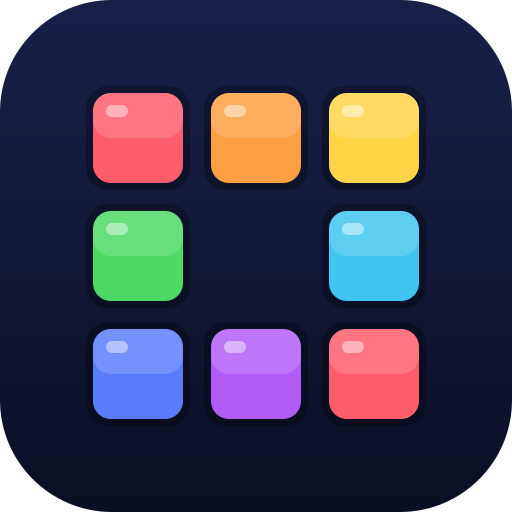

  

<h1 align="center">Lanternbit Labs</h1>

<b>Small games and apps, made fair.</b>

  <a href="https://lanternbitlabs.github.io">🌐 Website</a> ·
  <a href="mailto:lanternbit.labs@gmail.com">✉️ lanternbit.labs@gmail.com</a>

---

## 🎮 Games

| Game | About | Status | Links |
|---|---|---|---|
|  **Fair Square** | A calm block puzzle with fair pieces, fair ads and a Daily Puzzle | Coming soon to Google Play | [Privacy policy](https://lanternbitlabs.github.io/fair-square/privacy.html) |

## 🏮 Our promise

- **Fair play:** no rigged difficulty, no tricks to make you lose.
- **Respect for your time:** ads only between games, always announced; rewards stay your choice.
- **Your data stays yours:** no accounts needed, progress lives on your phone.

## ✉️ Contact

Feedback, ideas or bugs: **[lanternbit.labs@gmail.com](mailto:lanternbit.labs@gmail.com)**

---

© 2026 Lanternbit Labs

